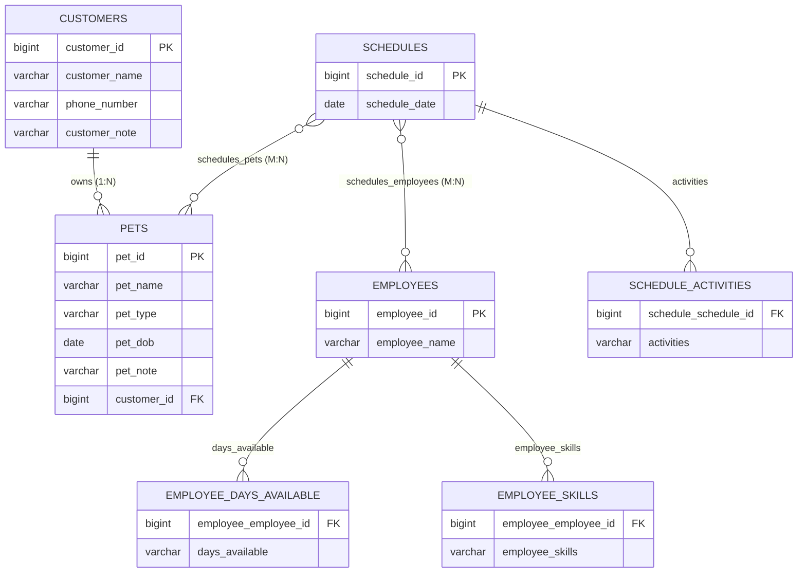

# 🐾 Critter Chronologer

<div align="center">


**A robust, full-featured Software as a Service (SaaS) backend scheduling & pet management system designed for animal daycares, veterinary clinics, and pet care businesses.**

[Features](#-features) • [Entity Relationship Diagram](#-entity-relationship-diagram) • [API Reference](#-api-reference) • [Getting Started](#-getting-started) • [Testing](#-testing) • [Screenshots](#-project-deliverables--screenshots)

---
</div>

## 📖 Table of Contents
- [Project Overview](#-project-overview)
- [Key Features](#-features)
- [Technology Stack](#-technology-stack)
- [Entity Relationship Diagram (ERD)](#-entity-relationship-diagram)
- [Project Structure](#-project-structure)
- [REST API Reference](#-api-reference)
- [Getting Started](#-getting-started)
  - [Prerequisites](#prerequisites)
  - [Database Setup](#1-mysql-database-configuration)
  - [Build and Run](#2-build--run-application)
- [Testing & Verification](#-testing)
  - [Automated Unit / Functional Tests](#automated-functional-tests)
  - [Postman API Test Suite](#postman-collection-testing)
- [Project Deliverables & Screenshots](#-project-deliverables--screenshots)
- [Author & License](#-author--license)

---

## 🌟 Project Overview

**Critter Chronologer** is a Spring Boot-driven backend service providing a complete scheduling and tracking interface for pet care organizations. The system seamlessly handles:
- **Customer Profiles**: Pet owners and contact details.
- **Pet Records**: Animal types, birthdates, and special handling instructions.
- **Staff Management**: Employees with dynamically assigned skills and weekly schedules.
- **Smart Scheduling**: Event scheduling linking staff, pets, and activities, with automated skill-and-availability matching queries.

All incoming and outgoing web traffic is decoupled from persistence models through dedicated **Data Transfer Objects (DTOs)**, safeguarding domain models from circular references and JSON recursion.

---

## 🚀 Features

- 🐶 **Comprehensive Pet Management**: Track pets, pet types (`CAT`, `DOG`, `LIZARD`, `BIRD`, `FISH`, `SNAKE`), notes, and automatically link pets to their respective owners.
- 👤 **Customer / Owner Portals**: Maintain customer rosters, associate multiple pets per customer, and retrieve customer records directly via pet ID.
- 🧑‍⚕️ **Staff Competencies & Availability Tracking**:
  - Employee skill sets (`PETTING`, `WALKING`, `FEEDING`, `MEDICATING`, `SHAVING`, etc.).
  - Workday availability matrix (`MONDAY` through `SUNDAY`).
- 🧠 **Intelligent Staff Matching Engine**:
  - Automatically queries and matches employees who are available on the requested date **AND** possess all required skills for requested services.
- 📅 **Multi-Entity Appointment Scheduling**:
  - Create and track complex appointments combining multiple employees, multiple pets, and custom service activities on designated calendar dates.
  - Query schedules filtered by Pet, Employee, or Customer.
- 🛡️ **Transactional Integrity**: All business logic transactions utilize `@Transactional` boundaries to guarantee data consistency.

---

## 🛠️ Technology Stack

| Category | Technology | Description |
| :--- | :--- | :--- |
| **Language** | Java 21+ | Modern Java runtime |
| **Framework** | Spring Boot 3.3.5 | Backend enterprise REST framework |
| **Persistence** | Spring Data JPA / Hibernate | Object-Relational Mapping (ORM) and repository abstractions |
| **Database** | MySQL 8.0+ | Production standalone relational database |
| **Testing DB** | H2 Database Engine | Fast in-memory database for isolated unit testing |
| **Build Tool** | Apache Maven 3.9+ | Dependency management and build lifecycle |
| **API Client** | Postman | End-to-end integration test execution |

---

## 📊 Entity Relationship Diagram

The application uses an efficient relational model with foreign keys, join tables for many-to-many relationships, and element collection tables for enums:



---

## 📁 Project Structure

```text
Critter Chronologer/
├── starter/critter/
│   ├── pom.xml                               # Maven project definitions & dependencies
│   ├── src/
│   │   ├── main/
│   │   │   ├── java/com/udacity/jdnd/course3/critter/
│   │   │   │   ├── CritterApplication.java   # Spring Boot entry point
│   │   │   │   ├── CritterController.java    # Health check endpoint (/test)
│   │   │   │   ├── pet/                      # Pet domain module
│   │   │   │   │   ├── Pet.java              # JPA Entity
│   │   │   │   │   ├── PetDTO.java           # Data Transfer Object
│   │   │   │   │   ├── PetType.java          # Animal type enum
│   │   │   │   │   ├── PetRepository.java    # Spring Data Repository
│   │   │   │   │   ├── PetService.java       # Pet business logic
│   │   │   │   │   └── PetController.java    # REST controller (/pet)
│   │   │   │   ├── schedule/                 # Schedule domain module
│   │   │   │   │   ├── Schedule.java         # JPA Entity
│   │   │   │   │   ├── ScheduleDTO.java      # Data Transfer Object
│   │   │   │   │   ├── ScheduleRepository.java
│   │   │   │   │   ├── ScheduleService.java  # Scheduling queries & logic
│   │   │   │   │   └── ScheduleController.java# REST controller (/schedule)
│   │   │   │   └── user/                     # Users domain module (Customer & Employee)
│   │   │   │       ├── Customer.java         # JPA Customer Entity
│   │   │   │       ├── CustomerDTO.java
│   │   │   │       ├── CustomerRepository.java
│   │   │   │       ├── CustomerService.java
│   │   │   │       ├── Employee.java         # JPA Employee Entity
│   │   │   │       ├── EmployeeDTO.java
│   │   │   │       ├── EmployeeRequestDTO.java
│   │   │   │       ├── EmployeeSkill.java    # Skill enum
│   │   │   │       ├── EmployeeRepository.java
│   │   │   │       ├── EmployeeService.java  # Availability matching logic
│   │   │   │       └── UserController.java   # REST controller (/user)
│   │   │   └── resources/
│   │   │       ├── application.properties    # MySQL datasource config
│   │   │       └── Udacity.postman_collection.json # Pre-built API collection
│   │   └── test/
│   │       ├── java/com/udacity/jdnd/course3/critter/
│   │       │   └── CritterFunctionalTest.java# Functional test suite (9 test cases)
│   │       └── resources/
│   │           └── application.properties    # H2 in-memory test config
├── Output & ER Diagram/                      # Project proof & database diagrams
│   ├── Screenshot 2026-07-07 at 2.40.08 PM.png # Server launch confirmation
│   ├── Screenshot 2026-07-07 at 2.42.15 PM.png # Complete Database ER Diagram
│   ├── Screenshot 2026-07-07 at 2.44.09 PM.png # Postman test execution runner
│   ├── Screenshot 2026-07-07 at 2.44.47 PM.png # 9/9 IntelliJ Functional Tests passed
│   └── Screenshot 2026-07-07 at 2.49.16 PM.png # Maven build success
└── README.md
```

---

## 📡 REST API Reference

Base Server URL: `http://localhost:8082`

### 👤 Customer Endpoints
| Method | Endpoint | Description |
| :--- | :--- | :--- |
| `POST` | `/user/customer` | Save a new customer |
| `GET` | `/user/customer` | Retrieve list of all registered customers |
| `GET` | `/user/customer/pet/{petId}` | Retrieve owner of a given pet ID |

### 🧑‍⚕️ Employee Endpoints
| Method | Endpoint | Description |
| :--- | :--- | :--- |
| `POST` | `/user/employee` | Register a new employee |
| `POST` | `/user/employee/{employeeId}` | Retrieve employee profile by ID |
| `PUT` | `/user/employee/{employeeId}` | Update an employee's days of availability |
| `GET` | `/user/employee/availability` | Find employees matching required skills and date |

### 🐾 Pet Endpoints
| Method | Endpoint | Description |
| :--- | :--- | :--- |
| `POST` | `/pet` | Save a new pet and link to owner |
| `GET` | `/pet/{petId}` | Retrieve pet by ID |
| `GET` | `/pet` | Retrieve all registered pets |
| `GET` | `/pet/owner/{ownerId}` | Retrieve all pets owned by customer ID |

### 📅 Schedule Endpoints
| Method | Endpoint | Description |
| :--- | :--- | :--- |
| `POST` | `/schedule` | Create a new service schedule |
| `GET` | `/schedule` | Retrieve all schedules |
| `GET` | `/schedule/pet/{petId}` | Retrieve all schedules for a specific pet |
| `GET` | `/schedule/employee/{employeeId}` | Retrieve all schedules for a specific employee |
| `GET` | `/schedule/customer/{customerId}` | Retrieve all schedules for a specific customer |

---

## 💻 Getting Started

### Prerequisites
- **Java**: JDK 21 or later
- **Maven**: Version 3.8+
- **MySQL Server**: Version 8.0+
- **Postman** (Optional, for API testing)

### 1. MySQL Database Configuration
Log in to your local MySQL terminal and create the schema:
```sql
CREATE DATABASE Critter_Chronologer_Exam;
```

Verify your database credentials in `starter/critter/src/main/resources/application.properties`:
```properties
server.port=8082
spring.jpa.defer-datasource-initialization=true

spring.datasource.url=jdbc:mysql://localhost:3306/Critter_Chronologer_Exam
spring.datasource.username=root
spring.datasource.password=YOUR_PASSWORD_HERE
spring.jpa.hibernate.ddl-auto=update

spring.jpa.show-sql=true
spring.jpa.properties.hibernate.format_sql=true
```

### 2. Build & Run Application
Navigate to the module directory and start the application:
```bash
cd starter/critter
mvn clean spring-boot:run
```

Once started, test the service in your browser or curl:
```bash
curl http://localhost:8082/test
```
*Expected response:*
```
Critter Starter installed successfully
```

---

## 🧪 Testing

### Automated Functional Tests
All 9 core functional tests validate entities, repository methods, cascading associations, and matching algorithms:

```bash
cd starter/critter
mvn test
```

**Tested Test Cases:**
1. `testCreateCustomer`: Verifies customer persistence and ID generation.
2. `testCreateEmployee`: Validates employee creation and skill persistence.
3. `testAddPetsToCustomer`: Validates pet creation with foreign key assignment to customer.
4. `testFindPetsByOwner`: Verifies querying multiple pets belonging to an owner.
5. `testFindOwnerByPet`: Verifies bidirectional lookup of customer via pet association.
6. `testChangeEmployeeAvailability`: Validates updating employee schedule availability days.
7. `testFindEmployeesByServiceAndTime`: Confirms skill matching and date-availability filtering.
8. `testSchedulePetsForServiceWithEmployee`: Validates schedule creation with pets, staff, and activities.
9. `testFindScheduleByEntities`: Verifies multi-faceted schedule lookups for pets, employees, and customers.

### Postman Collection Testing
1. Launch **Postman**.
2. Click **Import** and select `starter/critter/src/main/resources/Udacity.postman_collection.json`.
3. Run the collection against `http://localhost:8082`.
4. All endpoints execute and pass with `200 OK`.

---

## 📸 Project Deliverables & Screenshots

All execution proofs and architecture diagrams are preserved in the [`Output & ER Diagram`](Output%20%26%20ER%20Diagram/) directory:

### 1. Database Entity-Relationship Diagram (ERD)
*Generated schema layout illustrating primary keys, foreign keys, and junction tables:*

<div align="center">
  
</div>

---

### 2. Unit & Functional Tests Passing (9/9)
*All 9 test cases in `CritterFunctionalTest` passing in IntelliJ IDEA:*

<div align="center">
  
</div>

---

### 3. Postman Collection Test Execution
*Complete Postman collection running with 200 OK responses across all endpoints:*

<div align="center">
  
</div>

---

### 4. Application Startup & HikariCP Pool
*Spring Boot Tomcat running on port 8082 connected to MySQL:*

<div align="center">
  
</div>

---

## 👤 Author & License

Developed with ❤️ by **[Pushkaraj Joshi](https://github.com/j-pushkaraj)**

Licensed under the **MIT License**. See `LICENSE` for more information.
